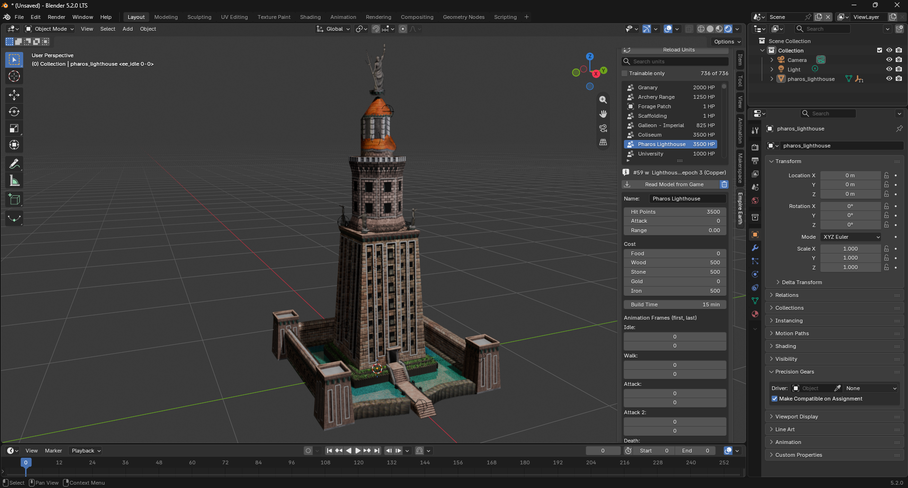
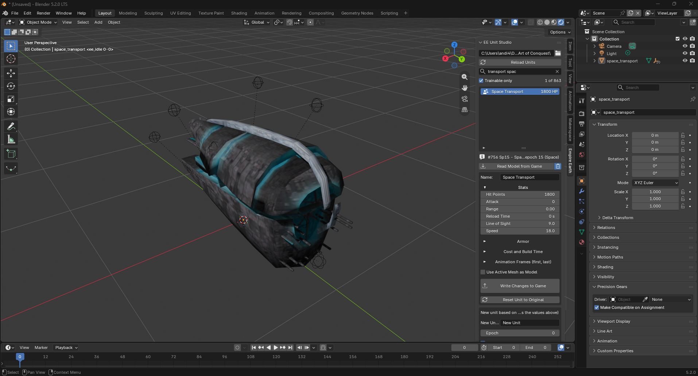
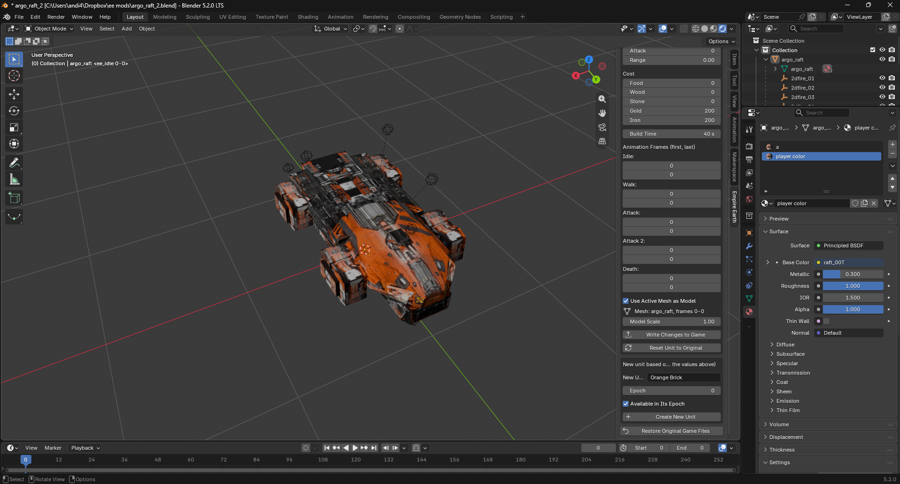
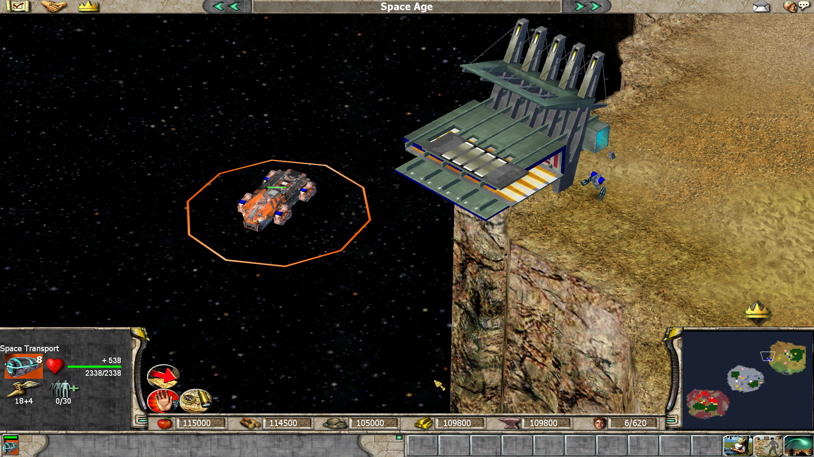

# Unit Studio for EE

**An unofficial, fan-made tool for editing and adding units in Empire Earth: The Art of Conquest.**

> This is just a little hobby project work in progress, don't expect everyting to work perfectly
> This project is not affiliated with, endorsed by or connected to the developers, publishers or rights holders of
> Empire Earth. "Empire Earth" is used only to describe which game the tool works with; all trademarks belong to their
> respective owners. The project contains **no files, graphics, models, sounds, texts or other content from the game**.
> You need your own, legally obtained copy of *Empire Earth* with *The Art of Conquest* to use it. The tool only reads
> and changes the game files of that copy on your own computer.









With it you can:

* replace a unit's 3D model and texture with your own, made in Blender,
* change a unit's name, hit points, attack, range, reload time, line of sight, speed, armor, cost, build time and animation frames,
* create new trainable units based on existing ones,
* import the game's models into Blender (on your own computer) as a reference for size, animation and attachment points.

## Requirements

* *Empire Earth: The Art of Conquest* installed.
* Blender (5.2)

## Installation

Drag and Drop the zip file into a blender window

or

Blender → Edit → Preferences → Add-ons → ▾ menu (top right) → **Install from Disk…** → pick
`ee_unit_studio-1.1.5.zip`. 

Then open the 3D Viewport sidebar (press **N**) → tab **Empire Earth**.

## Usage

1. Paste the folder of *The Art of Conquest* (the one containing `Language.dll`) into the path field and click
   **Load Units**. The original *Empire Earth* folder next to it is found automatically (most original models are
   stored there); if yours is somewhere else, set **Base Game Folder** in the add-on preferences.
2. Pick a unit in the list. The **search field** above it filters as you type: every word must appear in the unit's
   name or internal name (`long bow`, `tank`, `inf10`), and `#20` finds unit number 20. **Trainable only** hides
   buildings, animals and other objects. Units you changed are marked with a wrench, units you created with a
   plus (epoch looks with a changed model get a wrench too); **Modified only** lists just those.
   Many units and buildings change their look when a new epoch is reached (Citizen, Town Center, Capitol, House,
   Dock, Priest, …). Each **epoch look** has its own row below the unit, e.g. *Citizen – Stone*. With such a row
   selected, Read Model, Use Active Mesh as Model and the animation frames apply to that look; name, stats and cost
   always belong to the whole unit. A look shared with another unit is copied first, so the other unit keeps it.
3. **Read Model from Game** imports the unit with its texture, every animation frame (as shape keys) and its tag points
   (empties such as `attack`, `impact_00`). Timeline markers like `ee_walk 31-45` show which frames belong to which
   animation. With the trash-can toggle next to the button switched on, the previously imported model is deleted first
   (only objects created by an import, including copies of them; your own objects stay).
4. Change **Name, Hit Points, Attack, Range, Reload Time, Line of Sight, Speed, Armor, Cost, Build Time** or the **Animation
   Frames**, then click **Write Changes to Game**. Speed is shown as in the game (Clubman 12). Stats, Armor, Cost and
   Animation Frames are folded away; click their heading to open them.
5. To give the unit your own model, select your mesh and write: **Use Active Mesh as Model** is ticked by default
   (untick it to change only names, stats or animation frames without a mesh selected). The scene's frame
   range is exported (game frame 0 = the scene's start frame); keep it consistent with the animation frames.
   **Icon** (folded away, for trainable units) shows the unit's current button icon. Pick any image as the **New
   Icon** (it is scaled to 64×64; transparent parts get the **Background** color), or click **Render Icon from
   Model** to render the active mesh from the front right; **Zoom** and **Orbit** (and the background color)
   update the rendered icon right away. Write Changes to Game (or Create New Unit) gives it to the
   unit; other units that shared the button keep theirs. Reset Unit to Original brings the old icon back.
6. **Create New Unit** makes a new unit based on the selected one, with the values above (and the active mesh, if
   ticked). It gets its own button in the same buildings. **Epoch** 0 keeps the base unit's epoch. Created from an
   epoch-look row, the new unit has that look (it does not change its look with the epochs).
   **Available in Its Epoch** (on by default) makes it trainable as soon as that epoch is reached; switched off, it
   only becomes trainable together with its base unit (for example after the upgrade an upgrade-line unit needs). For
   units you created, the same checkbox appears among the unit's fields.
7. **Reset Unit to Original** puts the selected unit back as it was in the original game (name, stats, cost, build
   time, button, model, texture, animations, all epoch looks) without touching any other unit; a building keeps the
   units you created for it. Not available for units you created yourself.
8. **Restore Original Game Files** undoes every change.

Every write goes straight into the game files and takes a few seconds; close the game first. The first write backs
up `Data\data.ssa` and `Language.dll` as `*.orig`.

The add-on also adds File → Import / Export → **Empire Earth Model (.cem)** for working with model files directly.

### Building panels (node editor)

Which building trains which unit, and where its button sits, can be edited with nodes. Switch any editor to
**EE Building Panels** (the editor-type menu, next to Shader and Geometry Nodes), load the units in the 3D Viewport
first, then open the sidebar (**N**) → tab **Empire Earth**:

* **Add Building** adds **one epoch of a building** (or of the Citizen, for the buildings it builds): search e.g.
  *Barracks · Stone*. The node shows every button available in that epoch: the ones the epoch adds and those of
  earlier epochs that are still available (every tech has a first and a last epoch; the Clubman, for example, is
  available from Prehistoric to Renaissance). The inputs are the button slots: *Bottom · 1–16* is the bottom row of
  the in-game panel, *Row 2* and *Row 3* the rows above. Grey slots marked *free* are empty in every epoch and safe
  to use; slots of fixed buttons like Stop or Populate are left out. **Other Epochs** (on by default) shows the slots used only
  in other epochs (with their names), e.g. to give a unit the slot of the one it replaces.
* Each button is a small node on the left with its name, its first epoch and its in-game icon (brown ones are
  research; widen a node to read a long name); the building nodes show the building's icon. **Add Unit** adds any
  trainable unit; **Add Epoch** adds another epoch of the selected building (also one it has no buttons in yet).
* **Link** a unit to a slot: the building trains it there. Linked into a later epoch than its last one, it stays
  available there until that epoch. **Move the link** to another slot: the button moves.
* **Remove the link** in the node of the unit's first epoch: the building no longer has it at all. Remove it in a
  later epoch's node: it is no longer available there from that epoch on (also remove it from the epochs after
  that, as a unit cannot come back later). If other buildings have the same unit, this building first gets its own
  copy of it (same unit, button and upgrade events), so the others keep theirs.
* Buildings can share a unit (a building created from another one has all of its units). Moving such a unit, or
  ending it in a later epoch, in one building first gives that building its own copy of it (same unit, cost and
  upgrade events, its own button), so the other buildings keep theirs. Within one building a unit has one slot in
  all its epochs.
* **Write to Game** applies the links (only for the epochs that have a node; deleting a node changes nothing);
  **Reload from Game** discards links that were not written yet.

### Making a model

* Import a similar game unit and match its size and orientation. Infantry is about 1 unit tall, standing on z = 0.
* Any animation works (armature, shape keys, modifiers): the exporter records the evaluated mesh at every frame.
* Faces with a material whose name contains **player color** get the team color.
* Each material's **Image Texture** node is exported. Several images are allowed; they are stored together and scaled
  to the size of the first one (power of two, e.g. 128×128 or 256×256).
* The texture's **alpha channel is transparency**: the game cuts parts out where alpha is 0.
* Empties parented to the mesh become **tag points**: where shots start (`weapon_mount_00`), fire and explosions appear
  (`2dfire_0`, `end_2dfire_01`, `2dexplosion_0`), hits land (`impact_00`) and so on. The game looks them up by name and
  can freeze when one is missing, so every tag point of the unit's original model that your scene lacks is copied from
  the original automatically.
* Meshes parented directly to the main mesh are exported as **sub-models** (turrets, propellers, wheels). If there are
  none, the original sub-models are kept. A sub-model's **origin is its pivot**, and its name tells the game what to do:
  * `orbital_cw_200_00` **spins** clockwise, `orbital_ccw_400_01` counter-clockwise, around the object's **local Z axis**
    (propellers, rotors, radar dishes). The number in the middle is the speed: the game's planes and helicopters use
    about 200–400. The last number just keeps the names apart.
  * `turret_1` turns to aim.
  * Any other name stays fixed (it still moves with its own animation).

  So for a propeller: model it lying flat in its local XY plane around the origin, parent it to the main mesh, rotate
  and move the object to where it belongs and name it e.g. `orbital_cw_300_00`. Imported game models show their
  sub-models the same way, so you can copy them.
* The unit's animation frames must exist in your model; writing is refused otherwise.
* Keep it low-poly: the game's own infantry has roughly 200–400 triangles.

**Sharing your work:** only share models and textures you made yourself. Do not share files exported from or based on
the game's own models and textures, and never share modified game files (`data.ssa`, `Language.dll`) – let other
players apply your changes to their own copy with this tool instead.

## Command line (optional)

Place this folder inside the game folder of *The Art of Conquest* (next to `Language.dll`), then:

```
py ee_unitmod.py list bow                   # find unit names
py ee_unitmod.py extract "Inf01 - Clubman"  # copy a unit's model + texture into extracted\ (for your own use)
py ee_unitmod.py install                    # restore the original game files, then apply units.json
py ee_unitmod.py uninstall                  # put the original game files back
```

`install` always starts from the original files, so it also removes changes made with the add-on.

| `units.json` key | meaning |
|---|---|
| `name` (required) | name of the new unit |
| `base` (required) | unit to copy (name from `list`, or its number) |
| `epoch` | 1 = Prehistoric … 15 = Space; default: the base unit's |
| `available_now` | `true` (default): trainable as soon as its epoch is reached; `false`: together with the base unit |
| `hp`, `attack`, `range` | stats (range is 0.5 for melee units) |
| `reload_time`, `line_of_sight`, `speed` | e.g. `2`, `4` and `12` (the Clubman's values; reload time in seconds, speed as the game shows it) |
| `armor` | e.g. `{"shock": 2, "arrow": 1}`; types `shock`, `arrow`, `pierce`, `gun`, `laser`, `missile` |
| `food`, `wood`, `stone`, `gold`, `iron` | cost |
| `build_time` | seconds |
| `button_slot` | position in the building's panel: rows of 16 from the bottom (0–15 bottom row, 16–31 the row above, 32–47 the next); fixed buttons like Stop and Populate use the free places of the bottom row, the left column and a few more. Picked automatically if left out, avoiding all of these |
| `model`, `texture` | your own `.cem` / `.sst` (or uncompressed `.tga`) file, path relative to this folder |
| `animations` | e.g. `{"walk": [31, 45], "death": [46, 62]}`; slots `idle`, `walk`, `attack`, `attack2`, `death` |
| `icon` | an existing button texture of the game, e.g. `textures\\but_maceman_03T.sst` |
| `raw_object_fields` | `{"offset": value}` written straight into the unit's 1960-byte record (experts only) |

## Limits

* The computer players do not train new units (but replaced ones should work).
* Multiplayer works only if every player has the same changes.
* 11 of the game's models use a newer format (version 0x30001) that cannot be imported yet, e.g. the Priest's
  Digital look, the Industrial Town Center, the 88mm AA gun and the Cruiser. You can still replace them with your own
  model, but their animation frames cannot be changed on their own and their tag points cannot be copied.

## How it works

Technical notes on the file formats, found by analysing the data files for compatibility:

* `Data\data.ssa` is an archive (`rass` header, sorted lower-case file table); every file inside is PKWARE-DCL
  compressed behind a `PK01` header. *The Art of Conquest* also reads the original game's archive.
* `db\dbobjects.dat`: fixed 1960-byte records. Offsets: id 116, hp 120, range 132, line of sight 136, reload time
  (seconds) 140, speed 148
  (shown ×20 in the game), attack 192, armor 196–216 (shock, arrow, pierce, gun, laser, missile), button 296, graphics 300,
  name string id 472, number of tech-list entries 884, tech key 888, tech list 1156 (200 ints). The game reads only as
  many list entries as the count says.
* `db\dbtechtree.dat`: one section per epoch with variable-length records; buildings refer to a tech by
  key = (section + 1) × 1000 + index − 1. Costs: wood 124, stone 128, gold 136, iron 144, food 148; build time (ms) 152;
  prerequisite 156; created unit 172; button 176; event 116.
* `db\dbbuttons.dat`: 224-byte records: name, texture, id at 204, panel slot at 216 (rows of 16 filled from the
  bottom; fixed command buttons like Stop and Populate use the bottom row's free places, the left column and the
  places stored at offset 220 of their own records).
* `db\dbgraphics.dat`: 33 length-prefixed strings (name, model, texture, 30 extra texture slots) + 716 fixed bytes with
  the animation table.
* `db\dbevents.dat` and `db\dbeffects.dat`: researching a tech fires its event, whose effects can enable (type 8) or
  disable (type 9) other techs, or give a unit another graphics record (type 6: unit at offset 20, graphics at 36) –
  that is how the epoch events change the look of citizens and buildings.
* Unit names live in the string table of `Language.dll`; new names are added from id 40000 up.
* The `.cem` model and `.sst` texture formats are described at the top of `ee_unit_studio\cem.py`.

## License and credits

Unit Studio for EE is free software under the **MIT License** – see `LICENSE`.

It includes an altered version (a Python port) of `blast.c` by Mark Adler, from zlib's contrib folder, under the zlib
license; see `NOTICE.md`.

The tool is provided without any warranty. Back up your game before using it; you use it at your own risk.
